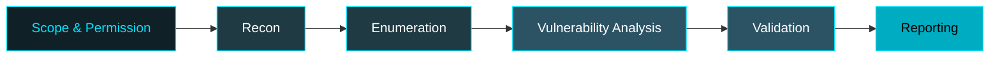

  

## 👤 Profile

<table>
<tr>
<td width="62%" valign="top">

| | |
|---|---|
| **Role** | Cybersecurity Student |
| **Specialisation** | Web Application Penetration Testing (WAPT) |
| **Interests** | Recon, vulnerability assessment, network security |
| **Building** | Security tools & practical security projects |
| **Approach** | Ethical, authorised testing only |
| **Open to** | Labs, CTFs, tool-building collaboration |

</td>
<td width="38%" align="center" valign="middle">

</td>
</tr>
</table>

> *"Learn. Test with Permission. Secure."*

## 🎯 Focus Areas

| 🔎 Reconnaissance | 🕷️ Web App Security | 🌐 Network Security | 🧪 Tool Development |
|:---:|:---:|:---:|:---:|
| Subdomain, port & service discovery | OWASP Top 10, auth, injection, access control | Scanning, enumeration, traffic analysis | Python-based scanners & automation |

## 🔄 Methodology

## 🚀 Featured Projects

| Project | Description |
|---|---|
| [**ScanR**](https://github.com/TocsiVector/ScanR) | Cybersecurity & threat-intelligence project |
| [**SmartSpamR**](https://github.com/TocsiVector/SmartSpamR) | AI-based spam detection & threat-intelligence project |

## 🧰 Tech Stack

 

  

## 📈 Learning Progress

| Topic | Progress |
|---|---|
| Linux & Networking |  |
| Reconnaissance & Enumeration |  |
| OWASP Top 10 |  |
| WAPT with Burp Suite |  |
| Vulnerability Reporting |  |

## 📊 GitHub Stats

## 🌐 Practice Platforms

### 🤝 Let's Connect

**GhostMaskR** · Beyond the Surface. Into the System.

