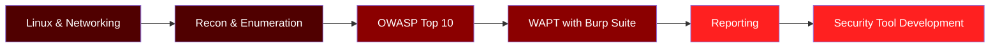

<div align="center">


<br/>


[](https://github.com/GhostMaskR)
[](https://github.com/GhostMaskR)
[](https://www.linkedin.com/in/rohit-kushwah-386493335/)

</div>

---

<div align="center">

<!-- Custom animated hacker terminal (file: assets/terminal.svg) -->


</div>

---

## 🔭 About Me

```bash
root@ghostmaskr:~# cat about.txt
```

- 🔐 Cybersecurity student focused on **Web Application Penetration Testing (WAPT)**
- 🕸️ Into reconnaissance, vulnerability assessment & network security
- 🛠️ Building security tools and practical security projects
- 🌱 Currently learning web security methodologies & pentesting techniques
- 👯 Open to collaborating on ethical hacking labs and security tools
- 💬 Ask me about **Linux, networking, recon, WAPT fundamentals, security tooling**
- ⚡ Motto: **Learn. Test with Permission. Secure.**

---

## 🚀 Projects

<div align="center">

| 🛰️ ScanR | 📧 SmartSpamR | 👻 GhostMaskR |
|:---:|:---:|:---:|
| Cybersecurity & threat-intelligence project | AI-based spam detection & threat-intel project | My security-tool development profile |
| [](https://github.com/TocsiVector/ScanR) | [](https://github.com/TocsiVector/SmartSpamR) | [](https://github.com/GhostMaskR) |

</div>

---

## 🧰 Skills & Technologies

<div align="center">

**Programming & Web**


**Cybersecurity & OS**


**Dev Tools**


**Security Tools**


</div>

---

## 📚 Currently Learning

```diff
+ Web Application Penetration Testing
+ OWASP Top 10
+ Reconnaissance & Enumeration
+ Linux & Network Security
+ Vulnerability Validation & Reporting
+ Cybersecurity Tool Development
```

---

## 🎯 Learning Roadmap



---

## 🌐 Practice Platforms

<div align="center">

[](https://portswigger.net/web-security)
[](https://owasp.org/www-project-top-ten/)
[](https://tryhackme.com/)
[](https://academy.hackthebox.com/)

</div>

---

## 📊 GitHub Stats

<div align="center">


</div>

## 📈 Contribution Activity

<div align="center">


</div>

## 🐍 Contribution Snake

<div align="center">


</div>

---

## 💭 Hacker Quote

<div align="center">


</div>

---

## 🌐 Find Me Online

<div align="center">

[](https://github.com/GhostMaskR)
[](https://github.com/TocsiVector)
[](https://www.linkedin.com/in/rohit-kushwah-386493335/)

### 🔴 LEARN • TEST WITH PERMISSION • SECURE


</div>
