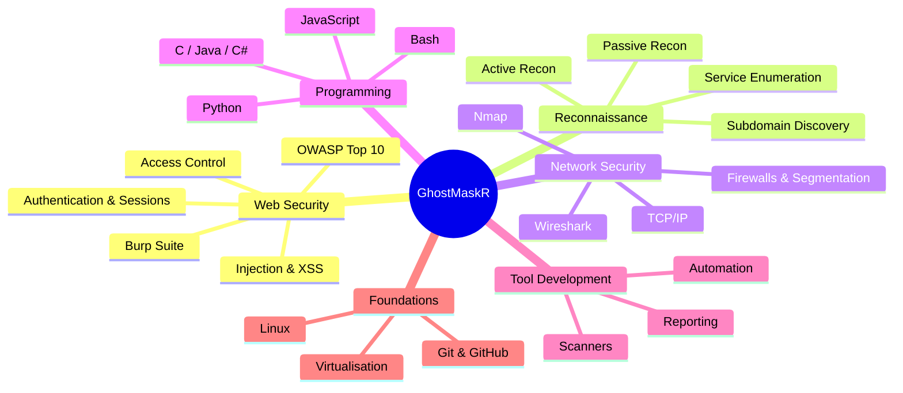
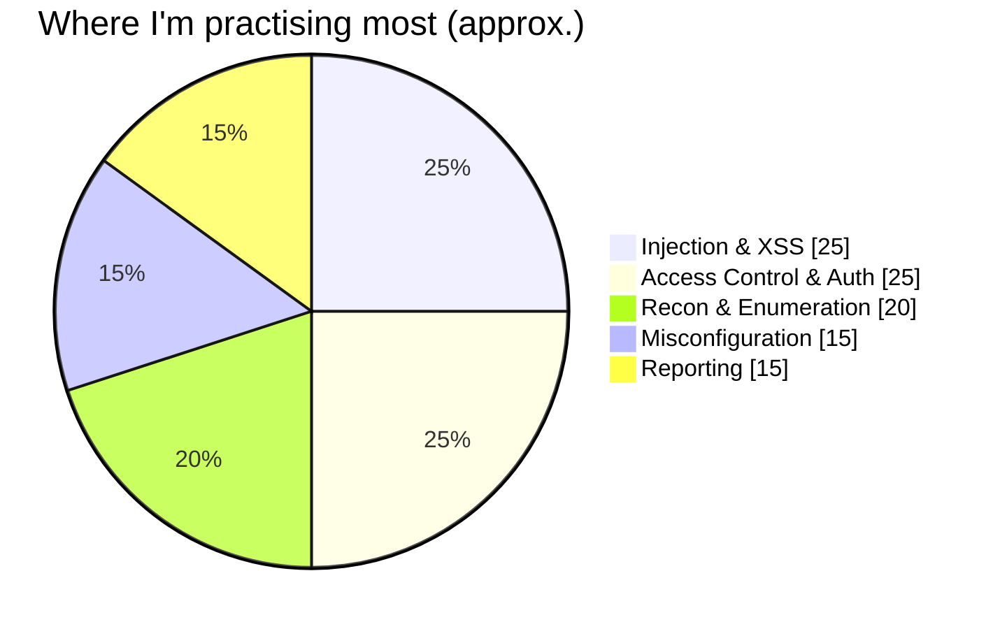
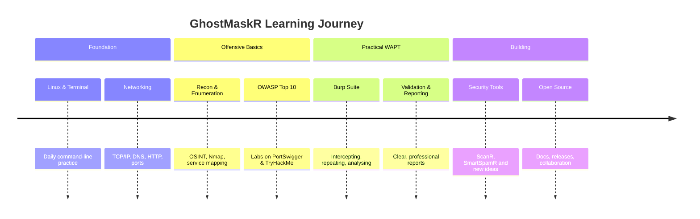
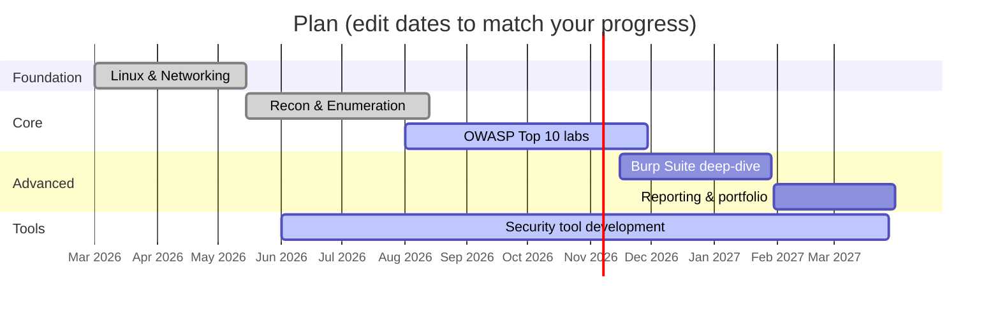

<!-- ═══════════════════════════════════════════════════════════════
     GhostMaskR · Cybersecurity Profile README
     Theme: matrix-green / black · Fully online assets (no local files)
     ═══════════════════════════════════════════════════════════════ -->

<div align="center">


<pre>
   ________               __  __  ___           __   ____
  / ____/ /_  ____  _____/ /_/  |/  /___ ______/ /__/ __ \
 / / __/ __ \/ __ \/ ___/ __/ /|_/ / __ `/ ___/ //_/ /_/ /
/ /_/ / / / / /_/ (__  ) /_/ /  / / /_/ (__  ) ,< / _, _/
\____/_/ /_/\____/____/\__/_/  /_/\__,_/____/_/|_/_/ |_|
</pre>


<br/>

<a href="https://github.com/GhostMaskR"></a>
<a href="https://github.com/TocsiVector"></a>
<a href="https://www.linkedin.com/in/rohit-kushwah-386493335/"></a>
<br/>


<br/><br/>


</div>


<!-- ───────────── TABLE OF CONTENTS ───────────── -->

<div align="center">

## 🧭 Navigation

| | | | |
|:---:|:---:|:---:|:---:|
| [👤 Whoami](#whoami) | [🎯 Mission](#mission) | [🧰 Arsenal](#arsenal) | [💻 Languages](#languages) |
| [🧠 Skill Tree](#skilltree) | [🔄 Methodology](#methodology) | [🚀 Projects](#projects) | [🧪 Code Lab](#codelab) |
| [🛡️ OWASP](#owasp) | [📒 Cheat Sheets](#cheatsheets) | [🗺️ Roadmap](#roadmap) | [🏆 Goals](#goals) |
| [📊 Stats](#stats) | [🌐 Labs](#labs) | [🤝 Connect](#connect) | [🐍 Snake Game](#snake) |
| [📡 Tech Radar](#radar) | [🗓️ Routine](#routine) | [📚 Library](#library) | [❓ FAQ](#faq) |

</div>

<!-- ───────────── AT A GLANCE ───────────── -->

<div align="center">

<table>
<tr>
<td align="center" width="25%"><h2>🎓</h2><b>Student</b><br/><sub>Cybersecurity</sub></td>
<td align="center" width="25%"><h2>🕷️</h2><b>Speciality</b><br/><sub>Web App Pentesting</sub></td>
<td align="center" width="25%"><h2>🛠️</h2><b>Builder</b><br/><sub>Security tools in Python</sub></td>
<td align="center" width="25%"><h2>🧪</h2><b>Practising</b><br/><sub>OWASP · Recon · Labs</sub></td>
</tr>
</table>


</div>

### ⚡ Currently

<table>
<tr>
<td width="60%" valign="top">

```yaml
now:
  learning:    OWASP Top 10 · Burp Suite workflow
  building:    Security tools in Python
  practising:  PortSwigger Academy & TryHackMe rooms
  improving:   Recon methodology · report writing
  next_up:     API security · Docker · cloud basics
```

</td>
<td width="40%" align="center" valign="middle">


</td>
</tr>
</table>

<!-- ───────────── WHOAMI ───────────── -->

<a id="whoami"></a>
## 👤 Whoami

```bash
root@ghostmaskr:~# whoami
ghostmaskr

root@ghostmaskr:~# cat /etc/profile.d/identity.conf
```

<table>
<tr>
<td width="60%" valign="top">

```yaml
identity:
  handle:        GhostMaskR
  role:          Cybersecurity Student
  speciality:    Web Application Penetration Testing (WAPT)
  also_into:     Recon · Network Security · Tool Development
  os:            Kali Linux / Linux
  editor:        VS Code
  philosophy:    Learn. Test with Permission. Secure.
  status:        🟢 online · learning · building
```

</td>
<td width="40%" align="center" valign="middle">


</td>
</tr>
</table>

### 📌 About Me

- 🔐 I study **cybersecurity** with a strong focus on **Web Application Penetration Testing (WAPT)**.
- 🕸️ I enjoy **reconnaissance**, **vulnerability assessment** and **network security**.
- 🛠️ I build **security tools** and practical projects to learn by doing.
- 🌱 Currently deepening my knowledge of **web security methodologies** and **pentesting techniques**.
- 👯 Always open to collaborating on **ethical hacking labs**, **CTFs** and **security tooling**.
- 💬 Ask me about **Linux, networking, reconnaissance, WAPT fundamentals** and **security tooling**.
- 🎯 **Goal:** build real, practical security skills — and useful open-source security projects.

<!-- ───────────── MISSION ───────────── -->

<a id="mission"></a>
## 🎯 Mission & Rules of Engagement

<div align="center"><br/></div>

> **"Security is not a product, it's a process — and it starts with permission."**

<div align="center">


</div>

| # | Rule | Why it matters |
|:-:|------|----------------|
| 1 | **Authorisation first** | Written scope & permission separates a pentest from a crime |
| 2 | **Stay in scope** | Only touch the assets that were agreed on |
| 3 | **Do no harm** | Avoid destructive actions, data loss and downtime |
| 4 | **Protect data** | Handle any found data confidentially and delete it afterwards |
| 5 | **Document everything** | Clear evidence and reproducible steps make a useful report |
| 6 | **Disclose responsibly** | Give owners time and detail to fix before anything goes public |
| 7 | **Keep learning** | Threats evolve — so must defenders |

<!-- ───────────── ARSENAL ───────────── -->

<a id="arsenal"></a>
## 🧰 Arsenal

<div align="center"><br/></div>

### 🔴 Security Tools

<div align="center">


</div>

### 🧪 Labs & Virtualisation

<div align="center">


</div>

### 🛠️ Dev & Everyday Tools

<div align="center">


</div>

<!-- ───────────── LANGUAGES ───────────── -->

<a id="languages"></a>
## 💻 Programming Languages

<div align="center"><br/></div>

<div align="center">


<br/><br/>


</div>

### 📶 Comfort Level

```text
Python      ████████░░  80%   automation · scripting · security tools
Bash        ███████░░░  70%   Linux workflows · log analysis · glue scripts
JavaScript  ██████░░░░  60%   how the browser works · XSS understanding
HTML / CSS  ███████░░░  70%   web structure · front-end fundamentals
C           █████░░░░░  50%   memory · low-level concepts
Java        █████░░░░░  50%   OOP · crypto APIs
C#          ████░░░░░░  40%   .NET fundamentals
SQL         ██████░░░░  60%   database basics · injection defence
```

### 🧭 Why each language matters for security

| Language | Role in my security journey |
|:--------:|-----------------------------|
|  **Python** | Fast prototyping of scanners, parsers, automation and report helpers |
|  **Bash** | Everyday Linux work, log triage, chaining tools into pipelines |
|  **JavaScript** | Understanding the browser, DOM, XSS and client-side logic |
|  **HTML/CSS** | Reading page structure, forms and how inputs reach the server |
|  **C** | Learning memory, pointers and why low-level bugs happen |
|  **Java** | OOP, enterprise apps and secure crypto API usage |
|  **C#** | .NET apps, parameterised queries, Windows ecosystem basics |

<!-- ───────────── SKILL TREE ───────────── -->

<a id="skilltree"></a>
## 🧠 Skill Tree

<div align="center"><br/></div>



### 🎯 Focus Areas

<div align="center">

| 🔎 Reconnaissance | 🕷️ Web App Security | 🌐 Network Security | 🧪 Tool Development |
|:---:|:---:|:---:|:---:|
| Discover assets, services and exposure | OWASP Top 10, auth, injection, access control | Scanning, enumeration, traffic analysis | Python-based scanners & automation |

</div>

<!-- ───────────── TECH RADAR ───────────── -->

<a id="radar"></a>
## 📡 Tech Radar

<div align="center"><br/></div>

| Ring | Technologies | Meaning |
|:----:|--------------|---------|
| 🟢 **Adopt** | Linux · Python · Bash · Nmap · Burp Suite · Git | Daily drivers I trust |
| 🔵 **Trial** | Nuclei · Wireshark · SQL · JavaScript internals | Using regularly, still maturing |
| 🟡 **Learning** | OWASP depth · authentication flaws · API testing | Active study right now |
| ⚪ **Next** | Docker · cloud security · CI/CD security · threat modelling | On the horizon |

<!-- ───────────── METHODOLOGY ───────────── -->

<a id="methodology"></a>
## 🔄 Methodology

```mermaid
flowchart LR
    A([Scope & Permission]) --> B[Recon]
    B --> C[Enumeration]
    C --> D[Vulnerability Analysis]
    D --> E[Validation]
    E --> F[Reporting]
    F --> G([Retest & Close])
    style A fill:#000,color:#00FF9C,stroke:#00FF9C
    style B fill:#03230F,color:#fff,stroke:#00FF9C
    style C fill:#03230F,color:#fff,stroke:#00FF9C
    style D fill:#064d22,color:#fff,stroke:#00FF9C
    style E fill:#064d22,color:#fff,stroke:#00FF9C
    style F fill:#00FF9C,color:#000,stroke:#00FF9C
    style G fill:#000,color:#00FF9C,stroke:#00FF9C
```



| Phase | What I do | Typical output |
|-------|-----------|----------------|
| **1. Scope** | Confirm targets, rules, time-window, permission | Signed scope / rules of engagement |
| **2. Recon** | Gather public info about the target (OSINT, DNS, tech stack) | Asset & technology list |
| **3. Enumeration** | Identify hosts, ports, services, endpoints, parameters | Attack-surface map |
| **4. Analysis** | Map findings to known weakness classes (OWASP, CWE) | Candidate vulnerabilities |
| **5. Validation** | Safely confirm that an issue is real — no damage | Proof of concept (minimal) |
| **6. Reporting** | Explain impact, evidence, severity and fix | Clear, actionable report |
| **7. Retest** | Verify that the fix actually closes the issue | Closure confirmation |


<!-- ───────────── PROJECTS ───────────── -->

<a id="projects"></a>
## 🚀 Projects

<div align="center"><br/></div>

<div align="center">

<a href="https://github.com/TocsiVector/ScanR"></a>
<a href="https://github.com/TocsiVector/SmartSpamR"></a>

</div>

### 🛰️ ScanR

> Cybersecurity & threat-intelligence project.


<a href="https://github.com/TocsiVector/ScanR"></a>

| Aspect | Details |
|--------|---------|
| **Goal** | Collect and organise security-relevant information to support analysis |
| **Domain** | Threat intelligence · security automation |
| **Why I built it** | To turn recon and analysis steps into repeatable, scriptable workflows |
| **What I learn** | API handling, parsing, data structuring, clean CLI design |

### 📧 SmartSpamR

> AI-based spam detection & threat-intelligence project.


<a href="https://github.com/TocsiVector/SmartSpamR"></a>

| Aspect | Details |
|--------|---------|
| **Goal** | Detect spam / suspicious messages using machine-learning techniques |
| **Domain** | AI for security · phishing & spam defence |
| **Why I built it** | Spam and phishing are the most common entry point for attacks |
| **What I learn** | Text processing, feature extraction, model evaluation |

**Ideas on my build list:**

- [ ] Recon helper that organises results into a clean report
- [ ] Log analyser that highlights suspicious patterns
- [ ] Security-headers checker for websites I am authorised to test
- [ ] Password-policy & hash-identification helper
- [ ] Small lab environment scripts for practice

<!-- ───────────── CODE LAB ───────────── -->

<a id="codelab"></a>
## 🧪 Code Lab — Defensive Snippets

<div align="center"><br/></div>

<div align="center">


</div>

> Small, **defensive** snippets I use to practise secure coding in each language. Click to expand.

<details>
<summary><b>🐍 Python — Password strength estimator</b></summary>

```python
import math
import re

def estimate_entropy(password: str) -> float:
    """Rough entropy estimate in bits based on character pools used."""
    pools = [
        (r"[a-z]", 26),
        (r"[A-Z]", 26),
        (r"\d", 10),
        (r"[^\w\s]", 32),
    ]
    size = sum(n for pattern, n in pools if re.search(pattern, password))
    return len(password) * math.log2(size) if size else 0.0

def rate(password: str) -> str:
    bits = estimate_entropy(password)
    if bits < 40:
        return "Weak"
    if bits < 60:
        return "Fair"
    if bits < 80:
        return "Strong"
    return "Very strong"

if __name__ == "__main__":
    for pw in ("password", "Ghost#Mask2026!", "correct-horse-battery-staple"):
        print(f"{pw:32} -> {rate(pw)} ({estimate_entropy(pw):.1f} bits)")
```

</details>

<details>
<summary><b>🐍 Python — File integrity checker (SHA-256)</b></summary>

```python
import hashlib
import sys

def sha256_file(path: str, chunk_size: int = 65536) -> str:
    digest = hashlib.sha256()
    with open(path, "rb") as handle:
        for block in iter(lambda: handle.read(chunk_size), b""):
            digest.update(block)
    return digest.hexdigest()

if __name__ == "__main__":
    for file_path in sys.argv[1:]:
        print(f"{sha256_file(file_path)}  {file_path}")
```

Use it to confirm that a downloaded tool or ISO matches the publisher's checksum.

</details>

<details>
<summary><b>🐍 Python — Safe database query (parameterised)</b></summary>

```python
import sqlite3

conn = sqlite3.connect(":memory:")
conn.execute("CREATE TABLE users (id INTEGER PRIMARY KEY, email TEXT)")
conn.execute("INSERT INTO users (email) VALUES (?)", ("admin@example.com",))

def find_user(email: str):
    # The ? placeholder keeps user input as DATA, never as SQL code.
    cur = conn.execute("SELECT id, email FROM users WHERE email = ?", (email,))
    return cur.fetchone()

print(find_user("admin@example.com"))
print(find_user("' OR '1'='1"))   # treated as plain text -> no match
```

</details>

<details>
<summary><b>🐚 Bash — Summarise failed SSH logins from a log</b></summary>

```bash
#!/usr/bin/env bash
# Usage: ./failed_logins.sh /var/log/auth.log
LOG="${1:-/var/log/auth.log}"

echo "Top source IPs with failed SSH passwords:"
grep "Failed password" "$LOG" \
  | awk '{print $(NF-3)}' \
  | sort | uniq -c | sort -nr | head -10
```

Defender mindset: find noisy sources, then block with a firewall rule or `fail2ban`.

</details>

<details>
<summary><b>🟨 JavaScript — Escape HTML to prevent XSS</b></summary>

```javascript
const escapeHTML = (value) =>
  String(value).replace(/[&<>"']/g, (ch) => ({
    "&": "&amp;",
    "<": "&lt;",
    ">": "&gt;",
    '"': "&quot;",
    "'": "&#39;",
  }[ch]));

const untrusted = '';
console.log(escapeHTML(untrusted));
// -> &lt;img src=x onerror=alert(1)&gt;   (rendered as text, not executed)
```

Better still: prefer `textContent` over `innerHTML` and add a Content-Security-Policy.

</details>

<details>
<summary><b>⚙️ C — Caesar cipher (learning pointers & strings)</b></summary>

```c
#include <stdio.h>
#include <ctype.h>

static void caesar(char *s, int shift) {
    for (; *s; s++) {
        if (isalpha((unsigned char)*s)) {
            char base = isupper((unsigned char)*s) ? 'A' : 'a';
            *s = (char)((*s - base + shift + 26) % 26 + base);
        }
    }
}

int main(void) {
    char msg[] = "Hello, GhostMaskR!";
    caesar(msg, 3);
    puts(msg);          /* Khoor, JkrvwPdvnU! */
    caesar(msg, -3);
    puts(msg);          /* Hello, GhostMaskR! */
    return 0;
}
```

A classic cipher is **not** secure — it is a great way to practise pointers, loops and bounds.

</details>

<details>
<summary><b>☕ Java — Password hashing with PBKDF2</b></summary>

```java
import javax.crypto.SecretKeyFactory;
import javax.crypto.spec.PBEKeySpec;
import java.security.SecureRandom;
import java.util.Base64;

public class PasswordHasher {
    public static String hash(char[] password) throws Exception {
        byte[] salt = new byte[16];
        new SecureRandom().nextBytes(salt);

        PBEKeySpec spec = new PBEKeySpec(password, salt, 210_000, 256);
        byte[] hash = SecretKeyFactory
                .getInstance("PBKDF2WithHmacSHA256")
                .generateSecret(spec)
                .getEncoded();

        return Base64.getEncoder().encodeToString(salt) + ":" +
               Base64.getEncoder().encodeToString(hash);
    }
}
```

Never store plain passwords: use a unique salt and a slow, standard key-derivation function.

</details>

<details>
<summary><b>🟪 C# — Parameterised SQL query</b></summary>

```csharp
using Microsoft.Data.SqlClient;

public static bool EmailExists(SqlConnection conn, string email)
{
    const string sql = "SELECT COUNT(1) FROM Users WHERE Email = @email";
    using var cmd = new SqlCommand(sql, conn);
    cmd.Parameters.AddWithValue("@email", email);   // input stays data
    return (int)cmd.ExecuteScalar() > 0;
}
```

</details>

<details>
<summary><b>🌐 HTML / HTTP — Basic security headers</b></summary>

```http
Content-Security-Policy: default-src 'self'; object-src 'none'; frame-ancestors 'none'
Strict-Transport-Security: max-age=31536000; includeSubDomains
X-Content-Type-Options: nosniff
Referrer-Policy: strict-origin-when-cross-origin
Permissions-Policy: camera=(), microphone=(), geolocation=()
```

| Header | Protects against |
|--------|------------------|
| `Content-Security-Policy` | XSS, data injection, clickjacking |
| `Strict-Transport-Security` | Downgrade & man-in-the-middle on HTTP |
| `X-Content-Type-Options` | MIME-sniffing attacks |
| `Referrer-Policy` | Leaking URLs to third parties |
| `Permissions-Policy` | Unwanted access to browser features |

</details>


<!-- ───────────── OWASP ───────────── -->

<a id="owasp"></a>
## 🛡️ OWASP Top 10 — Study Notes

<div align="center"><br/></div>

> Based on the **2021 edition**. Always check [owasp.org](https://owasp.org/www-project-top-ten/) for the latest version.

| ID | Category | Core idea | Main defence |
|:--:|----------|-----------|--------------|
| **A01** | Broken Access Control | Users act outside their permissions | Deny by default, enforce checks server-side |
| **A02** | Cryptographic Failures | Sensitive data poorly protected | TLS everywhere, strong algorithms, key management |
| **A03** | Injection | Untrusted data interpreted as code | Parameterised queries, input validation, encoding |
| **A04** | Insecure Design | Missing security in the design itself | Threat modelling, secure design patterns |
| **A05** | Security Misconfiguration | Defaults, open services, verbose errors | Hardening, minimal installs, config reviews |
| **A06** | Vulnerable & Outdated Components | Using libraries with known flaws | Inventory, patching, dependency scanning |
| **A07** | Identification & Authentication Failures | Weak login / session handling | MFA, strong password policy, session protection |
| **A08** | Software & Data Integrity Failures | Unverified updates, pipelines, data | Signatures, integrity checks, secure CI/CD |
| **A09** | Security Logging & Monitoring Failures | Attacks go unnoticed | Central logs, alerting, incident response |
| **A10** | Server-Side Request Forgery (SSRF) | Server fetches attacker-chosen URLs | Allow-lists, network segmentation, URL validation |



<!-- ───────────── CHEAT SHEETS ───────────── -->

<a id="cheatsheets"></a>
## 📒 Cheat Sheets

<div align="center"><br/></div>

> Quick-reference notes I keep for labs and study. Use them **only on systems you own or are authorised to test.**

<details>
<summary><b>🐧 Linux essentials</b></summary>

| Command | Purpose |
|---------|---------|
| `ls -la` | List files incl. hidden, with permissions |
| `cd`, `pwd` | Move around / show current path |
| `cat`, `less`, `head`, `tail -f` | Read files / follow logs live |
| `grep -rin "text" .` | Search text recursively, case-insensitive |
| `find / -name "*.conf" 2>/dev/null` | Find files by name |
| `chmod 640 file` / `chown user:group file` | Change permissions / ownership |
| `ps aux`, `top`, `kill PID` | Inspect and manage processes |
| `ss -tulpn` | List listening ports and owning processes |
| `ip a`, `ip r` | Show interfaces and routes |
| `sudo -l` | Show what sudo rights the current user has |
| `systemctl status <service>` | Check service state |
| `journalctl -xe` | Read recent system logs |
| `tar -czf out.tgz dir/` | Compress a directory |
| `curl -I https://example.com` | Fetch only HTTP response headers |

**Permission quick-math:** `r=4 · w=2 · x=1` → `640` = owner `rw-`, group `r--`, others `---`.

</details>

<details>
<summary><b>📡 Nmap basics (authorised targets only)</b></summary>

| Flag | Meaning |
|------|---------|
| `-sV` | Detect service versions |
| `-sC` | Run default safe scripts |
| `-p 80,443` / `-p-` | Specific ports / all 65535 ports |
| `-T3` / `-T4` | Timing template (normal / faster) |
| `-Pn` | Skip host discovery (treat host as up) |
| `-oN file.txt` | Save normal-format output |
| `--top-ports 100` | Scan the 100 most common ports |

```bash
# Example: service/version scan of a lab VM I own
nmap -sV -sC -T4 -oN lab_scan.txt 192.168.56.101
```

</details>

<details>
<summary><b>🔌 Common ports & services</b></summary>

| Port | Service | Notes |
|:----:|---------|-------|
| 20/21 | FTP | Plain-text; prefer SFTP |
| 22 | SSH | Use keys, disable root login |
| 23 | Telnet | Insecure, legacy |
| 25 | SMTP | Mail transfer |
| 53 | DNS | UDP/TCP |
| 80 | HTTP | Unencrypted web |
| 110 / 143 | POP3 / IMAP | Mail retrieval |
| 443 | HTTPS | Encrypted web |
| 445 | SMB | File sharing — keep off the internet |
| 3306 | MySQL | Database — restrict access |
| 3389 | RDP | Remote desktop — protect with MFA/VPN |
| 5432 | PostgreSQL | Database — restrict access |
| 8080 | HTTP-alt | Dev / proxy servers |

</details>

<details>
<summary><b>🧾 Web-test checklist (for authorised assessments)</b></summary>

- [ ] Confirm scope, test window and permission in writing
- [ ] Map the application: pages, forms, parameters, APIs
- [ ] Review authentication: login, reset, MFA, lockout
- [ ] Review session handling: cookies flags, expiry, logout
- [ ] Check access control: horizontal & vertical privilege separation
- [ ] Test input handling: validation, encoding, error messages
- [ ] Review file-upload and download behaviour
- [ ] Inspect security headers and TLS configuration
- [ ] Check for information leakage (debug pages, backups, verbose errors)
- [ ] Record evidence, severity and clear remediation advice

</details>

<details>
<summary><b>📝 Report template</b></summary>

```markdown
# Finding: <short title>

**Severity:** Low | Medium | High | Critical
**Affected asset:** <URL / host / component>
**Category:** <e.g. OWASP A01 – Broken Access Control>

## Summary
One or two sentences describing the issue.

## Impact
What could realistically happen if this is abused?

## Steps to reproduce
1. ...
2. ...

## Evidence
Screenshots / request-response excerpts (sanitised).

## Recommendation
Clear, practical fix.

## References
OWASP, CWE, vendor docs.
```

</details>


<!-- ───────────── ROUTINE ───────────── -->

<a id="routine"></a>
## 🗓️ Weekly Routine

<div align="center"><br/></div>

| Day | Focus | Output |
|:---:|-------|--------|
| **Mon** | Recon & enumeration practice | Notes on new techniques |
| **Tue** | Web labs (PortSwigger / THM) | 1–2 labs solved |
| **Wed** | Networking & traffic analysis | Wireshark / Nmap write-up |
| **Thu** | Coding security tools | Commits to ScanR / SmartSpamR |
| **Fri** | Reporting practice | One clean mock finding |
| **Sat** | CTF / lab rooms | Challenge solved or analysed |
| **Sun** | Review & rest | Plan for the next week |

> *Consistency beats intensity — small daily progress compounds.*

<!-- ───────────── LIBRARY ───────────── -->

<a id="library"></a>
## 📚 Library — What I Read & Recommend

<div align="center"><br/></div>

| Book | Author | Why it helps |
|------|--------|--------------|
| *The Web Application Hacker's Handbook* | Dafydd Stuttard & Marcus Pinto | Foundation for web app testing |
| *Real-World Bug Hunting* | Peter Yaworski | How real vulnerabilities are found and reported |
| *Linux Basics for Hackers* | OccupyTheWeb | Comfort in the Linux terminal |
| *Black Hat Python* | Justin Seitz | Python for security tooling |
| *Serious Cryptography* | Jean-Philippe Aumasson | Understanding crypto the right way |

<!-- ───────────── ROADMAP ───────────── -->

<a id="roadmap"></a>
## 🗺️ Roadmap

<div align="center"><br/></div>





### ✅ Progress Checklist

- [x] Set up Kali Linux / virtual lab (VirtualBox / VMware)
- [x] Learn Linux basics and the terminal
- [x] Publish first security projects (ScanR, SmartSpamR)
- [ ] Finish PortSwigger Web Security Academy core topics
- [ ] Complete OWASP Top 10 labs
- [ ] Solve consistent TryHackMe rooms / paths
- [ ] Write 5 professional mock pentest reports
- [ ] Publish a recon / reporting automation tool
- [ ] Contribute to an open-source security project

<!-- ───────────── GOALS ───────────── -->

<a id="goals"></a>
## 🏆 Goals & Future Certifications

<div align="center"><br/></div>

| Goal | Type | Status |
|------|------|:------:|
| Web Application Penetration Testing skill-set | Skill | 🟢 In progress |
| CompTIA Security+ | Certification | 🟡 Planned |
| eJPT (Junior Penetration Tester) | Certification | 🟡 Planned |
| PNPT / OSCP-path preparation | Certification | ⚪ Future |
| Bug-bounty participation (within programme rules) | Practice | ⚪ Future |
| Publish a polished security tool | Project | 🟢 In progress |


<!-- ───────────── STATS ───────────── -->

<a id="stats"></a>
## 📊 GitHub Stats

<div align="center"><br/></div>

<div align="center">


</div>

<!-- ───────────── LABS ───────────── -->

<a id="labs"></a>
## 🌐 Labs & Learning Resources

<div align="center"><br/></div>

<div align="center">

<a href="https://portswigger.net/web-security"></a>
<a href="https://tryhackme.com/"></a>
<a href="https://academy.hackthebox.com/"></a>
<a href="https://owasp.org/www-project-top-ten/"></a>
<a href="https://owasp.org/www-project-web-security-testing-guide/"></a>
<a href="https://nmap.org/book/"></a>

</div>


<!-- ───────────── QUOTE ───────────── -->

<div align="center">


</div>

<!-- ───────────── FAQ ───────────── -->

<a id="faq"></a>
## ❓ FAQ

<div align="center"><br/></div>

<details>
<summary><b>Do you test systems without permission?</b></summary>

Never. I only practise on my own labs, intentionally vulnerable platforms, or targets where I have **written authorisation**.

</details>

<details>
<summary><b>What should I message you about?</b></summary>

Linux, networking, recon basics, WAPT fundamentals, security tooling, lab ideas, CTF teamwork or open-source collaboration.

</details>

<details>
<summary><b>Where should a beginner in cybersecurity start?</b></summary>

Linux and networking first, then web basics (HTTP, HTML, JavaScript), then OWASP Top 10 with hands-on labs on PortSwigger Academy and TryHackMe.

</details>

<details>
<summary><b>Which tools do you use most?</b></summary>

Kali Linux, Burp Suite, Nmap, Nuclei, Wireshark and Python for custom automation.

</details>

<details>
<summary><b>Are your projects open source?</b></summary>

Yes — see [ScanR](https://github.com/TocsiVector/ScanR) and [SmartSpamR](https://github.com/TocsiVector/SmartSpamR). Issues and ideas are welcome.

</details>

<!-- ───────────── CONNECT ───────────── -->

<a id="connect"></a>
## 🤝 Connect

<div align="center"><br/></div>

<div align="center">


<br/><br/>

<a href="https://www.linkedin.com/in/rohit-kushwah-386493335/"></a>
<a href="https://github.com/GhostMaskR"></a>
<a href="https://github.com/TocsiVector"></a>

</div>

```text
┌─────────────────────────────────────────────────┐
│  GhostMaskR  ::  contact                        │
├─────────────────────────────────────────────────┤
│  github    github.com/GhostMaskR                │
│  projects  github.com/TocsiVector               │
│  linkedin  /in/rohit-kushwah-386493335          │
│  status    open to labs · CTFs · collaboration  │
└─────────────────────────────────────────────────┘
```

<!-- ───────────── SNAKE GAME ───────────── -->

<a id="snake"></a>
<div align="center">

## 🐍 Snake Game — Playing on My Contributions

<div align="center"><br/></div>

<sub>The snake eats my GitHub contributions automatically. Updated every 12 hours by GitHub Actions.</sub>

<br/><br/>

<picture>
  <source media="(prefers-color-scheme: dark)" srcset="https://raw.githubusercontent.com/GhostMaskR/GhostMaskR/output/github-contribution-grid-snake-dark.svg">
  <source media="(prefers-color-scheme: light)" srcset="https://raw.githubusercontent.com/GhostMaskR/GhostMaskR/output/github-contribution-grid-snake.svg">
  
</picture>

</div>

---

<div align="center">

### 🔴 LEARN • TEST WITH PERMISSION • SECURE

<sub><b>GhostMaskR</b> · Beyond the Surface. Into the System.</sub>


</div>
